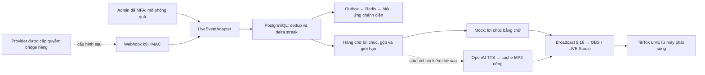

# TikTok LIVE và lời chúc

**Trạng thái: người dùng chọn mô phỏng trước.** Không có tài khoản provider/key giọng đọc; chưa nhận hoặc đọc quà thật từ TikTok. Không dùng cookie đăng nhập TikTok, không scrape danh tính, không suy đoán liên kết tài khoản từ nickname.



## Thử ngay, không cần trả tiền

1. Tạo/xác minh tài khoản, cấp quyền Admin bằng CLI, thiết lập MFA theo README.
2. Mở `/admin`, phần TikTok LIVE; bấm **Mô phỏng nhận quà**. API này cần quyền và không có endpoint giả quà công khai.
3. Worker lưu/chuẩn bị lời chúc. Bấm **Tạo phiên màn hình OBS**, mở màn hình broadcast và bấm cho phép nhận lời chúc/âm thanh.
4. Mặc định chỉ hiện chữ. Có thể bật giọng thiết bị khi đang tạm dừng, nếu máy có voice tiếng Việt; đây là SpeechSynthesis của thiết bị, **không phải dịch vụ giọng AI đã tích hợp**. Không có voice thì vẫn hiện chữ.
5. Capture vùng `.broadcast-canvas` 9:16 trong OBS, không capture bảng điều khiển; output audio qua thiết bị/nguồn phù hợp. Chưa kiểm thử OBS/TikTok LIVE Studio thật.

Token broadcast nằm trong fragment khi mở link, được chuyển vào bộ nhớ trang và bỏ khỏi URL; không gửi trong query/log. Hết hạn sau 30 phút. Tải lại cần mở lại link còn hạn hoặc cấp link mới. Không chia sẻ link; token chỉ đọc/nhận phát lời chúc, không có quyền Admin. Chỉ một consumer claim một lời chúc. Nếu consumer chết, lease hết hạn đánh dấu thất bại, không tự phát lại câu có thể đã đọc. Đây là lựa chọn tránh đọc trùng; không hứa exactly-once khi trình duyệt chết giữa lúc phát.

## Chuẩn bị nguồn quà thật sau này

TikTok không mặc định cấp API công khai đọc mọi gift LIVE. Cần xác nhận provider/đối tác có quyền đọc sự kiện, điều khoản, quyền LIVE của tài khoản và định dạng dữ liệu thực tế. Bộ webhook hiện có là **hợp đồng của ứng dụng**, không phải chữ ký/endpoint chính thức của TikTok. Provider thường cần một bridge server chuyển đổi sự kiện của họ sang hợp đồng này.

Bridge gửi POST `/api/integrations/live/events` với JSON:

```json
{
  "liveId": "live_001",
  "sourceEventId": "provider_event_unique_id",
  "senderId": "stable_provider_sender_id",
  "displayName": "Tiểu Vũ",
  "giftId": "rose",
  "count": 5,
  "streakId": "provider_streak_001"
}
```

Với streak, `count` là tổng tích lũy; event 1,2,3,4,5 chỉ tạo delta tổng 5. Với quà đơn không có streak, bỏ `streakId` và mỗi sự kiện phải có source ID riêng. Không được tự tạo ID khác mỗi lần retry; uniqueness là `(provider,liveId,sourceEventId)`.

Server đọc secret nhị phân tối thiểu 32 byte từ `LIVE_WEBHOOK_SECRET_FILE` (không commit). Bridge dùng cùng secret qua kênh quản lý bí mật riêng và tạo:

```text
X-Live-Timestamp: Unix time milliseconds (13 chữ số)
X-Live-Signature: lowercase hex HMAC-SHA256(secret, timestamp + "." + exact UTF-8 JSON bytes)
Content-Type: application/json
```

Không đổi whitespace/thứ tự JSON sau khi ký. Server dùng so sánh constant-time, chấp nhận cửa sổ ±5 phút, chống replay bằng source ID. Khi chưa cấu hình file secret, endpoint trả 503. HTTPS vẫn bắt buộc ở production. Không lưu secret phía client, không để frontend tự gửi sự kiện provider.

Chưa có danh tính TikTok đã xác minh liên kết tài khoản game: mọi hiệu ứng là cảm ơn chung; quà không tự điều khiển nhân vật, không cấp xu/ghế hoặc ưu tiên FIFO. `tiktokConnected` vẫn false vì nhận được webhook của bridge không tự chứng minh bridge kết nối TikTok.

## Bật giọng AI thật sau này

Đã có nhánh adapter **chưa kiểm thử với dịch vụ** cho OpenAI speech. Cấu hình `TTS_PROVIDER=openai`, cấp `OPENAI_API_KEY` phía worker thông qua environment settings/secret binding đến `api.openai.com`, và thêm host này vào allowlist nếu cần. Không dán key vào chat hoặc Git. Giữ TLS/CA/proxy, không tắt kiểm tra chứng chỉ. Mặc định `TTS_PROVIDER=mock` không cần key và không phát sinh phí TTS.

Adapter dùng endpoint `POST https://api.openai.com/v1/audio/speech`, model `gpt-4o-mini-tts`, voice `coral`, MP3; cần kiểm tra quyền model, chất lượng tiếng Việt, thời lượng, giá và điều khoản trên tài khoản thực trước khi sử dụng. Âm thanh được gắn thông báo giọng AI trên broadcast. Cache theo model/voice/text; file audio không public, cần token broadcast. TTS lỗi không làm hỏng chỗ ngồi, nghi lễ hoặc hàng chờ.

Hiện budget hàng chờ là 60 giây theo khoảng cách phát, gộp cùng người gửi trong 10 giây nếu chưa phát; job quá 60 giây chuyển sang fallback chữ. Một người đọc tại một thời điểm. Mẫu lời chúc do Admin xuất bản; tên được giới hạn ký tự/độ dài và có danh sách từ chặn cơ bản, không phải bộ kiểm duyệt hoàn hảo. Có nút bỏ qua; broadcast kiểm tra trạng thái để dừng phát khi bị skip. Mixer đã có ducking/khôi phục âm lượng cho file được người vận hành chọn trên máy; chưa kiểm chứng với kinh được cấp phép/OBS thật. Xem [EXPANSION.md](EXPANSION.md) cho hiệu ứng và lịch thiền chung.
